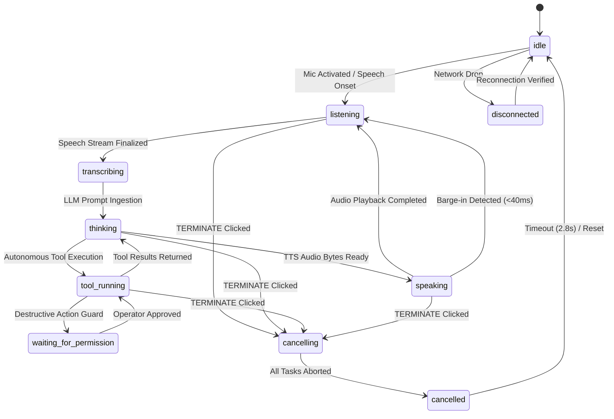

# JARVIS UI Explicit State Machine Specification

**Document Compliance:** PRD Section FR-006 & Addendum Section 11

## State Graph

## State Invariants
1. **True State Reporting:** "Jarvis is listening" only appears when the microphone capture loop is actually active.
2. **Deterministic Cancellation:** Clicking `TERMINATE` triggers `audioService.playTerminateAlarm()`, drains active queues, stops running tools, and informs the operator without closing the app.
