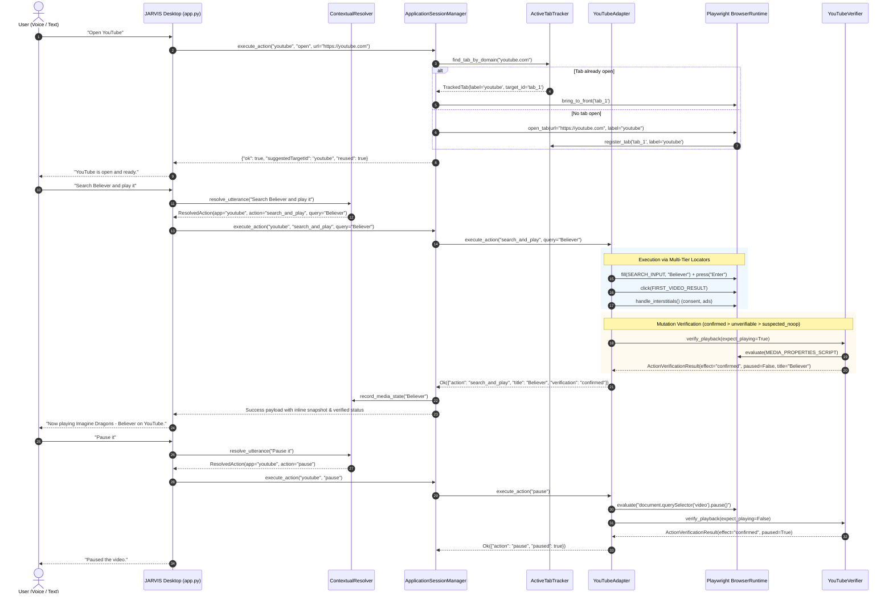

# Application Automation Runtime Flow

This document details the end-to-end execution flow of the JARVIS Application Automation Runtime, demonstrating how multi-turn interactions, tab reuse, pronoun resolution, and mutation verification operate in practice.

---

## 1. Architectural Flow Diagram

---

## 2. Detailed Phase Breakdown

### Phase 1: Request Normalization & Pronoun Resolution
- **Component**: `src/application_automation/contextual_resolver.py`
- When user input arrives (voice transcription or text), `ContextualResolver` inspects:
  1. Does the utterance contain anaphoric references (*"it"*, *"the song"*, *"this video"*)?
  2. Is there an active application tab in `ActiveTabTracker` (e.g. YouTube)?
  3. What is the current application state (`SEARCH_RESULTS`, `VIDEO_PLAYING`, `VIDEO_PAUSED`)?
- Maps elliptical commands to explicit target actions without requiring the user to repeat the application name or query.

### Phase 2: Tab Affinity & Safe Reuse
- **Component**: `src/application_automation/active_tab_tracker.py` & `extensions/browser/src/browser_runtime.py`
- Open tabs are indexed with:
  $$\text{aliases} = \{\text{targetId}, \text{tabId}, \text{label}, \text{suggestedTargetId}\}$$
- When a user repeats *"Open YouTube"*, the runtime:
  1. Resolves `label="youtube"`.
  2. Brings the existing tab to the foreground.
  3. Checks URL: if the user is already on a watch page or search results within `youtube.com`, it **skips** the root URL `goto()`, preserving the user's active media and DOM state.

### Phase 3: Multi-Tier Execution & JavaScript Fallback
- **Component**: `src/application_automation/applications/youtube/actions.py`
- Commands execute through a 4-tier locator cascade:
  1. **Tier 1 (ARIA / Roles)**: `input[aria-label="Search"]`, `button.ytp-play-button`.
  2. **Tier 2 (Custom Elements)**: `ytd-searchbox`, `ytd-video-renderer a#video-title`.
  3. **Tier 3 (CSS Selectors)**: Hierarchical container selectors.
  4. **Tier 4 (JavaScript DOM API)**: `document.querySelector('video').play()`, `video.pause()`, direct form submissions.

### Phase 4: Interstitial Interception & Auto-Recovery
- **Component**: `src/application_automation/applications/youtube/recovery.py`
- Before and after every mutating action:
  - Detects Google Cookie Consent dialogs and automatically clicks *"Accept all"*.
  - Detects YouTube Premium promotional modals and automatically clicks *"Dismiss"*.
  - Detects video pre-roll/mid-roll advertisements and monitors for clickable *"Skip Ad"* buttons.

### Phase 5: Mutation Effect Verification
- **Component**: `src/application_automation/applications/youtube/verifier.py`
- Inspects real HTML5 `<video>` metrics:
  - `paused`: Boolean flag indicating whether the media stream is stopped.
  - `currentTime`: Floating-point timestamp in seconds. Verifies advancement across a 0.3s window.
  - `readyState`: Ensures buffer status is $\ge 3$ (`HAVE_FUTURE_DATA`).
- Only returns `effect: "confirmed"` when genuine media rendering is validated.
