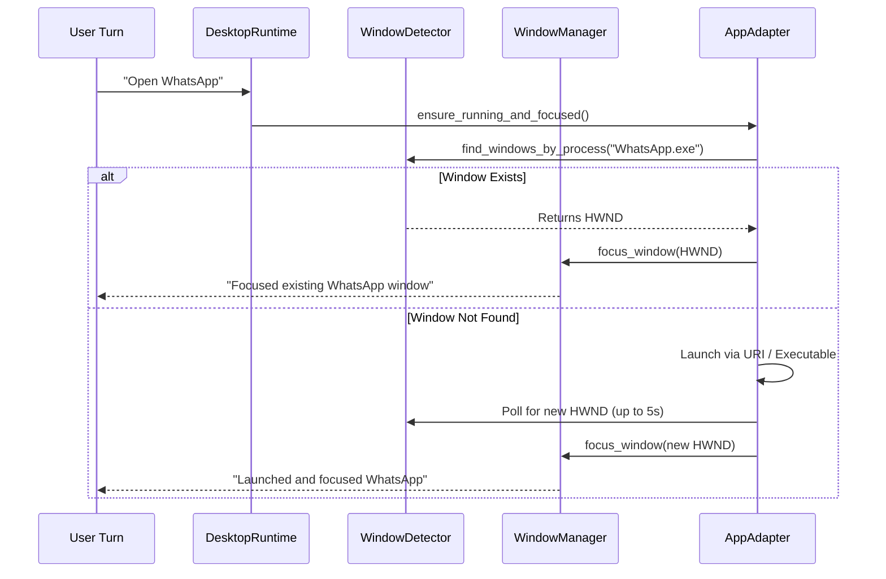

# JARVIS Desktop Control & Application Automation Architecture

**Implementation Reference:** `src/desktop_automation/`  
**OpenClaw Reference:** `src/agents/tools/computer-tool.ts`

---

## 1. Architectural Principles

JARVIS desktop control is built upon three foundational rules:
1. **Single-Instance Enforcement**: Never launch duplicate windows of an application already running. If WhatsApp, VS Code, or Calculator is open, bring the existing window to the front.
2. **Deterministic Focus & Window Geometry**: Query physical window handles (`HWND`), verify window placement (`RECT`), and explicitly bring to top via Win32 `SetForegroundWindow` and `BringWindowToTop`.
3. **Application-Specific Adapters**: Standardize common applications (WhatsApp, VS Code, Office, Calculator, File Explorer) with dedicated adapters that know their keyboard shortcuts, process names, and UI hierarchies.

---

## 2. Component Structure

```text
src/desktop_automation/
├── __init__.py                 # Exports DesktopRuntime, WindowManager, WindowDetector, etc.
├── core/
│   ├── desktop_runtime.py      # Central coordinator for desktop actions
│   ├── window_manager.py       # Win32 HWND manipulation, focus, minimize/restore
│   ├── window_detector.py      # EnumWindows, process-to-HWND mapping, title search
│   ├── input_controller.py     # Win32 SendInput / PyAutoGUI mouse & keyboard automation
│   ├── safety_guard.py         # Confirmation bounds for destructive operations
│   └── task_continuity.py     # Pronoun and utterance resolution
├── adapters/
│   ├── base_adapter.py         # Abstract base adapter contract
│   ├── whatsapp_adapter.py     # WhatsApp Desktop (chat search, message typing, call)
│   ├── vscode_adapter.py       # Visual Studio Code (commands, file open, terminal)
│   ├── office_adapter.py       # Word, PowerPoint, Excel automation
│   ├── calculator_adapter.py   # Windows Calculator integration
│   ├── explorer_adapter.py     # Windows File Explorer navigation
│   └── generic_adapter.py      # Fallback Win32 window automation
└── state/
    ├── active_desktop_context.py # Foreground window tracking & prompt formatting
    └── global_state_tracker.py   # Shared runtime state for desktop automation
```

---

## 3. Dedicated Application Adapters

### 3.1 WhatsApp Desktop Adapter (`whatsapp_adapter.py`)
- **Protocol / Executable**: Detects `WhatsApp.exe` or launches via `whatsapp://`.
- **Search & Navigate**: Focuses window, triggers search hotkey (`Ctrl + F`), enters recipient name, navigates with `Enter`.
- **Message Sending**: Types message into the active input box and presses `Enter`.
- **Calling**: Triggers voice or video call shortcuts.
- **Error Handling**: Gracefully reports if WhatsApp is not running or search yielded no contacts.

### 3.2 Visual Studio Code Adapter (`vscode_adapter.py`)
- **Command Palette**: Triggers `Ctrl + Shift + P` and executes named commands.
- **Quick Open**: Triggers `Ctrl + P` to navigate to workspace files.
- **Terminal Integration**: Toggles terminal via `Ctrl + \``.

### 3.3 Calculator Adapter (`calculator_adapter.py`)
- Evaluates mathematical expressions using native Windows Calculator keyboard shortcuts or direct verified math calculation.

### 3.4 Office & Explorer Adapters
- Automates document creation, text insertion, folder navigation, and file selections.

---

## 4. Single-Instance & Focus Flow


