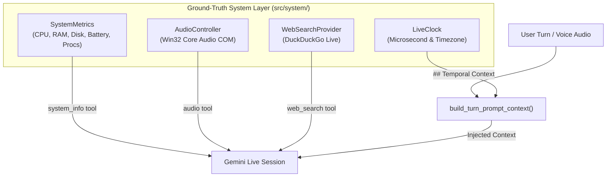

# JARVIS Real-Time Data & System Telemetry Architecture

**Implementation Reference:** `src/system/`  
**OpenClaw Reference:** Node `os` module bindings, `extensions/duckduckgo/`

---

## 1. Architectural Philosophy

A personal AI assistant operating on a host computer must be anchored to **ground-truth reality**. Whenever the user asks:
- "What time is it?"
- "How much RAM is free?"
- "What's the weather in Kathmandu today?"
- "What is my current master volume?"

The assistant must query physical hardware and network APIs rather than predicting tokens probabilistically.

---

## 2. Core Real-Time Subsystems

### 2.1 Live Clock (`src/system/live_clock.py`)
- Direct system clock access via Python's standard `time` and `datetime` libraries with microsecond precision.
- Automatic local timezone resolution (e.g. `Asia/Kathmandu` or system standard tzinfo) and UTC offset calculation.
- Renders 12-hour human formats (`06:45:10 PM`), 24-hour formats (`18:45:10`), and ordinal day formatting (`12th`).
- Exports `build_temporal_context_prompt()` injected automatically into user conversation turns.

### 2.2 System Metrics Telemetry (`src/system/system_metrics.py`)
- **CPU**: Physical and logical core count, live utilization percentage, current clock frequency (MHz).
- **RAM**: Total, used, available memory in gigabytes, and memory consumption percentage.
- **Disk**: Multi-drive root inspection (`C:\`, `E:\`, etc.), calculating total capacity, used space, and free space in GB.
- **Battery**: Percentage charge, AC power plugged status, and estimated remaining battery life.
- **Network**: Active interface enumerations and IPv4 host addresses.
- **Processes**: Real-time snapshot of top running desktop processes sorted by memory or CPU consumption.

### 2.3 Windows Core Audio Controller (`src/system/audio_controller.py`)
- Directly interacts with Windows Core Audio via native COM interfaces (`CLSID_MMDeviceEnumerator`, `IID_IAudioEndpointVolume`).
- Pure Python implementation using `ctypes` without third-party C-extensions or external wheels.
- Enforces strict scalar normalization between `[0.0, 1.0]` (hardware level) and `[0, 100]%` (user level).
- Performs mandatory post-mutation readback verification: any `set_volume` or `set_mute` call physically checks the audio hardware before returning.

### 2.4 Resilient Web Search Provider (`src/system/web_search_provider.py`)
- Provides live web search for weather, news, stock/crypto prices, and facts.
- Connects to DuckDuckGo search endpoints with zero required API keys.
- Implements automatic HTTP fallback to ensure resilience even in constrained network environments.
- Returns formatted, bounded snippets with source titles and canonical URLs.

---

## 3. Data Flow Diagram

