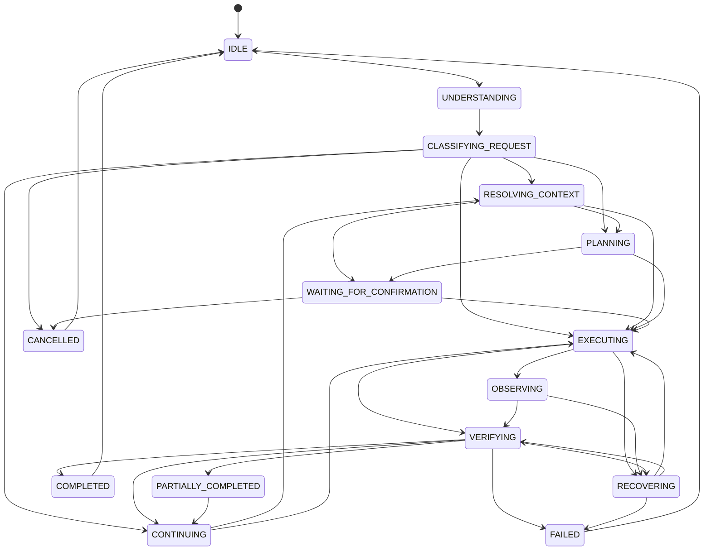

# JARVIS 18-State Workflow Lifecycle State Machine

**Implementation Reference:** `src/agents/task/workflow_state_machine.py`  
**OpenClaw Reference:** `src/tasks/task-status.ts`, `src/agents/tools/session-status-tool.ts`

---

## 1. Architectural Overview

To eliminate ambiguous "THINKING" black-boxes and provide full transparency into the agent's internal progress, JARVIS implements an authoritative **18-State Workflow State Machine**.

Every task turn progresses through explicit states, and each transition emits a typed `ProgressEvent` that can be observed by UI renderers, logging pipelines, and background telemetry subscribers.



---

## 2. The 18 Discrete Lifecycle States

1. **`IDLE`**: Ready and listening for incoming user voice or text input.
2. **`UNDERSTANDING`**: Parsing raw input, voice transcripts, or multimodal desktop frames.
3. **`CLASSIFYING_REQUEST`**: Evaluating intent via `TaskClassifier` (e.g. `NEW_TASK`, `CONTINUE_ACTIVE_TASK`, `RETRY_FAILED_STEP`).
4. **`RESOLVING_CONTEXT`**: Resolving relative pronouns ("pathaideu", "save it", "send it"), target windows, active files, and temporal context.
5. **`PLANNING`**: Decomposing complex multi-step goals into a discrete sequence of steps with target tools.
6. **`WAITING_FOR_CONFIRMATION`**: Awaiting explicit user approval for destructive or high-risk actions (file deletion, process termination, system shutdown).
7. **`EXECUTING`**: Invoking a registered tool, native Windows API, or subagent process.
8. **`OBSERVING`**: Inspecting tool outputs, exit codes, process lists, or UI accessibility trees.
9. **`VERIFYING`**: Performing physical operating system verification via `ExecutionVerifier` (confirming file presence, reading back audio volume, checking exit codes).
10. **`CONTINUING`**: Automatically advancing to the next pending step in an active multi-step task ledger.
11. **`PAUSED`**: Temporarily suspended by user command or while yielding for long-running background tasks.
12. **`WAITING_FOR_USER`**: Blocked on missing user clarification, parameters, or disambiguation.
13. **`RECOVERING`**: Autonomous self-healing via `RecoveryDecisionEngine` (parameter repair, tool fallback).
14. **`PARTIALLY_COMPLETED`**: Certain steps succeeded, but remaining steps encountered a boundary requiring user intervention.
15. **`COMPLETED`**: All planned steps successfully executed and verified against physical OS reality.
16. **`FAILED`**: Execution failed and all automated recovery strategies have been exhausted.
17. **`BLOCKED`**: Prerequisites or required system resources are unavailable on the host PC.
18. **`CANCELLED`**: Explicitly aborted by user instruction ("cancel", "stop this", "chhodideu").

---

## 3. Progress Event Schema

Every state transition generates a `ProgressEvent`:

```json
{
  "event_id": "evt_4a2c918f01b3",
  "task_id": "80648c92-task-001",
  "previous_state": "EXECUTING",
  "new_state": "VERIFYING",
  "step_index": 2,
  "total_steps": 4,
  "message": "Executing physical volume readback verification",
  "timestamp": 1789218200.125,
  "details": {
    "tool_name": "audio",
    "target": "volume:50%"
  }
}
```

---

## 4. Status Snapshot Generation

Parity with OpenClaw's `task-status.ts`:
```python
sm = WorkflowStateMachine()
snapshot = sm.format_status_snapshot()
# Returns:
# {
#   "state": "VERIFYING",
#   "task_id": "...",
#   "step_index": 2,
#   "total_steps": 4,
#   "seconds_in_state": 0.45,
#   "recent_events": [...]
# }
```
