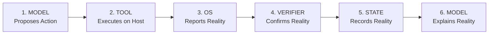

# JARVIS Truthfulness & Physical Verification Architecture

**Implementation Reference:** `src/agents/verification/execution_verifier.py`  
**OpenClaw Reference:** Verification contracts across `src/agents/agent-tools.*`

---

## 1. The Anti-Hallucination & Truthfulness Rule

In JARVIS, conversational claims must never be decoupled from physical reality. The core principle is defined by the **6-Tier Truthfulness Contract**:



1. **MODEL proposes**: The LLM determines the appropriate tool and arguments.
2. **TOOL executes**: The tool invokes native OS APIs or system calls.
3. **OS reports reality**: The operating system returns physical status (exit code, bytes written, HWND, scalar volume).
4. **VERIFIER confirms reality**: `ExecutionVerifier` performs independent validation against physical storage or hardware.
5. **STATE records reality**: The verified outcome is committed to `TaskStateManager` and SQLite transcripts.
6. **MODEL explains reality**: The model speaks or writes its reply based **only** on the verified result.

---

## 2. Physical Verification Methods

### 2.1 File System Operations
- **`write`**: Verifies that the file exists on disk and its byte size matches the written buffer.
- **`mkdir`**: Verifies directory existence via `Path.is_dir()`.
- **`remove_path`**: Verifies that the path no longer exists on the file system (`not Path.exists()`).
- **`rename_path`**: Verifies that the source path is gone and the destination path exists.
- **`edit`**: Verifies that the new text fragment is physically present in the file on disk.

### 2.2 System Audio & Volume
- **`audio`**: Uses `IAudioEndpointVolume::GetMasterVolumeLevelScalar` to read back master volume from hardware. If the volume target was 50% but readback returns 42%, the action is flagged as a failure or discrepancy.
- **Mute**: Directly queries `IAudioEndpointVolume::GetMute` to ensure hardware mute matches requested state.

### 2.3 Process & Window Execution
- **`exec`**: Verifies process exit code (code 0 = success, non-zero = failure). Inspects `stderr` for unhandled exceptions or syntax errors.
- **`desktop`**: Verifies that target application process is running and its window has been brought to the foreground via Win32 `GetForegroundWindow()`.

### 2.4 Web Search
- **`web_search`**: Confirms that query returned structured results or clean zero-result messages, avoiding fabricated search citations.

---

## 3. Truthful Escalation

When physical verification fails and autonomous self-healing is exhausted, JARVIS **never pretends** the action succeeded. It escalates truthfully to the user:

```text
Action could not be verified on host PC.
- Requested Tool: audio (set_volume to 80%)
- Hardware Status: Master volume remains at 42%
- Reason: Audio endpoint volume lock by exclusive mode application.
```
