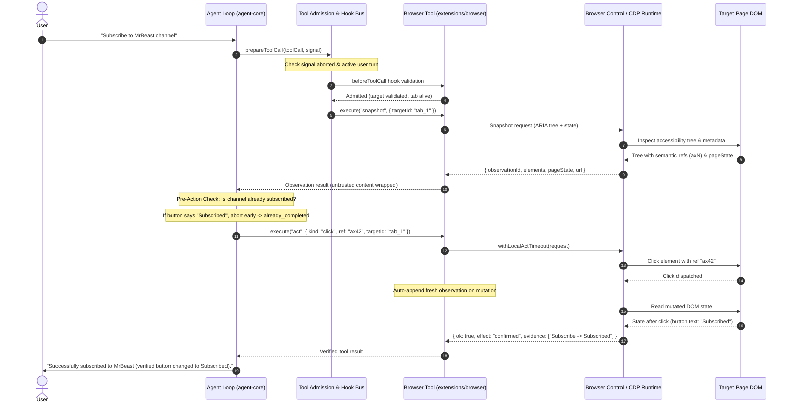

# OpenClaw Browser Execution Architecture Audit

**Repository Version**: OpenClaw v2026.9.2  
**Schema Versions**: `state`: 16, `agent`: 19  
**Source Path**: `c:/Users/kcs23/Downloads/openclaw-main`  
**Date**: September 2026  
**Auditor**: Senior Autonomous-Agent Systems & Reliability Engineer  

---

## 1. Executive Summary

OpenClaw's browser and computer-use automation is built around an **observation-driven, state-verified, mutation-guarded lifecycle**. Unlike naive browser automation systems that issue blind clicks and trust `{ "ok": true }` as mission success, OpenClaw operates under a strict reliability contract:
1. **Never trust `ok: true` as goal fulfillment**: A tool executing successfully means only that the automation protocol was dispatched; the real-world effect must be verified by comparing pre- and post-action observations.
2. **Result Precedence**: Mutation actions obey `effect: "confirmed" > unverifiable > suspected_noop`. Action evidence alone never proves the user's goal.
3. **Stale Reference Invalidation**: Any navigation, DOM mutation, or context epoch change invalidates observation IDs, element references (`elementRef`), and coordinate frames (`frameId`). Stale references force an explicit re-observation.
4. **Turn-Bound Tool Admission**: Tool calls are admitted through a lifecycle hook (`beforeToolCall`) bound to an `AbortSignal`. Delayed or orphaned tool calls from previous or cancelled turns are immediately rejected.
5. **Durable Session & Tab Routing**: Tabs are tracked via durable profiles, target IDs, tab IDs, and semantic labels to prevent cross-tab contamination and wrong-tab actions.

---

## 2. Complete Runtime Pipeline: User Request to Final Verified Response



---

## 3. Detailed Source Breakdown & Technical Mechanisms

### 3.1 How OpenClaw Knows Current Browser State
- **Source**: `extensions/browser/src/browser-tool.snapshot.ts`, `src/agents/tools/computer-tool-guidance.ts:95-172`
- **Mechanism**:
  - OpenClaw never relies on the language model's conversation memory or raw text history to track state.
  - State is queried explicitly via `snapshot` (ARIA tree) or `get_window_state` / `screenshot`.
  - Every observation produces an immutable `observationId` and binds elements to short-lived semantic handles (`elementRef`).
  - Untrusted external page content is strictly sanitized via `wrapBrowserExternalText` and `wrapBrowserExternalJson` before presentation to the model. This prevents prompt injections from on-screen DOM text.
  - Page classification attributes (`page_type`, `load_state`, `url`, `title`, `domain`) are resolved directly from the browser runtime metadata.

### 3.2 How OpenClaw Selects a Target Tab & Prevents Wrong-Tab Actions
- **Source**: `extensions/browser/src/browser-tool-session-tabs.ts:8-90`, `extensions/browser/src/browser-tool.actions.ts:116-151`
- **Mechanism**:
  - Tabs are tracked in a `SessionTabRegistry` with `sessionKey`, `targetId`, `tabId`, `label`, `route`, and `profile`.
  - When opening a tab, `readOpenedTab()` normalizes aliases (`targetId`, `tabId`, `label`, `suggestedTargetId`).
  - OpenClaw validates the target prior to dispatching actions:
    - If `targetId` is omitted, OpenClaw rejects the action or resolves it against the session's active designated target.
    - If the caller supplies a target ID that does not exist in the session registry, OpenClaw does not switch blindly to an arbitrary tab; it triggers `tabs` enumeration to reconcile state.
    - Profiles isolate browsing environments (e.g. `chrome`, `incognito`, `isolated_session`), ensuring that tabs in Profile A cannot receive actions intended for Profile B.

### 3.3 How OpenClaw Handles Stale Selectors & References
- **Source**: `extensions/browser/src/browser-tool.actions.ts:217-248`, `src/agents/tools/computer-tool-guidance.ts:162-167`, `src/agents/tools/computer-tool-result.ts:69-105`
- **Mechanism**:
  - **Error Classification**: In `browser-tool.actions.ts`, `isChromeStaleTargetError(usesChromeMcp, err)` checks if the status is 404 or "tab not found".
  - **Context Epoch & Frame Invalidation**: `invalidateComputerFrameIfMissing` in `computer-tool-result.ts` tracks `contextEpoch.value`. When new observations occur, previous screenshot coordinates and element references are invalidated (`contextEpoch.value += 1; delete contextEpoch.frameToolCallId; delete contextEpoch.frameImageIdentity;`).
  - **Guidance Contract**: `computer-tool-guidance.ts:162`: *"Stale observationId, elementRef, or windowRef means take a fresh observation and use only its refs."*
  - **Navigation Invalidation**: When any action causes navigation, `appendNavigatedPageState()` in `browser-tool.actions.ts` immediately attaches a fresh snapshot of the newly navigated page to the action result. The model is forbidden from reusing selectors from before the navigation.

### 3.4 How OpenClaw Validates Actions (Pre- & Post-Action)
- **Source**: `src/agents/tools/computer-tool-guidance.ts:156-158`, `extensions/browser/src/browser-tool.actions.ts:65-110`
- **Mechanism**:
  - **Action Timeouts**: Actions specify strict timeouts via `withLocalActTimeout()` (`DEFAULT_BROWSER_ACTION_TIMEOUT_MS = 20_000ms`). Hanging selectors abort cleanly instead of stalling the agent loop indefinitely.
  - **Pre-action Inspection**: Model guidance mandates `get_window_state` / `snapshot` *before* attempting mutations (`hasMutation ? ... Re-observe before another mutation, and never blind-retry a mutation`).
  - **Action Precedence**: Result precedence is:
    $$\text{effect: "confirmed"} > \text{unverifiable} > \text{suspected\_noop}$$
    An action is only considered confirmed if the post-action observation demonstrates that the expected state change occurred (e.g., button label transition, URL change, DOM node appearance).

### 3.5 How OpenClaw Handles Tool Calls After Turn Ends (Lifecycle & Stale Suppression)
- **Source**: `packages/agent-core/src/agent-loop.ts:1040-1115`
- **Mechanism**:
  - Tool calls are processed in `prepareToolCall(batch, toolCall)`.
  - Every batch carries an `AbortSignal` (`batch.signal`).
  - Before any tool call resolution or execution:
    ```typescript
    if (batch.signal?.aborted && !cachedValidation) {
      return {
        kind: "immediate",
        result: createErrorToolResult("Operation aborted"),
        isError: true,
      };
    }
    ```
  - The `beforeToolCall` hook is invoked with the current turn context. If the turn was completed, cancelled, or superseded by a new user instruction, `beforeResult.block` is returned, or the aborted signal halts execution with zero side-effects.
  - This completely prevents delayed, out-of-turn, or autonomous tool executions when the user has already stopped speaking or switched commands.

### 3.6 How OpenClaw Knows Whether a Task Succeeded & Prevents Fake Completion
- **Source**: `src/agents/tools/computer-tool-guidance.ts:156-158`, `extensions/browser/src/browser-tool.actions.ts:178-195`
- **Mechanism**:
  - `{ "ok": true }` is strictly treated as transport/runtime acknowledgment (i.e., the CDP/Playwright driver delivered the event without a runtime exception).
  - OpenClaw distinguishes between:
    1. `tool_command_accepted`: The driver received the request.
    2. `tool_action_executed`: The click/type event was fired.
    3. `page_state_changed`: The DOM mutated.
    4. `requested_effect_detected`: The specific target property changed.
    5. `requested_effect_verified`: Authoritative verification passed against postconditions.
  - Guidance explicitly forbids reporting task completion when verification fails: *"action evidence alone does not prove the user's goal."*

### 3.7 How OpenClaw Recovers from Failed Actions
- **Source**: `extensions/browser/src/browser-tool.actions.ts:225-248`, `src/agents/tools/computer-tool-guidance.ts:159-164`
- **Mechanism**:
  - Structured refusals: `background_unavailable`, `background_occluded`, `off_space_or_ax_unresolved` are returned as structured diagnostics, prompting the agent to escalate delivery mode (e.g., from background to foreground) rather than slamming the same selector.
  - If a target is stale, `replaceStaleTargetIdInActRequest()` checks for refreshed targets.
  - Blind repeated retries are prohibited by guidance: the agent must re-observe before attempting an alternative action.

---

## 4. Key Architectural Takeaways for JARVIS

| Dimension | OpenClaw v2026.9.2 Pattern | Current JARVIS Vulnerability |
| :--- | :--- | :--- |
| **State Tracking** | Central `observationId`, `contextEpoch`, ARIA tree snapshot | Textual prompt memory only; model forgets current page state |
| **Tab Management** | `SessionTabRegistry` with target IDs, aliases, and route validation | Tab IDs passed without re-validating domain or target lifecycle |
| **Pre-Action Check** | Mandatory observe-before-act; checks if already completed | Blindly clicks without checking if already in target state (e.g., Subscribe) |
| **Selector Handling** | Accessibility semantic refs (`elementRef`); auto-invalidation on navigation | Guessing CSS selectors; repeated retries of failing selectors |
| **Turn Boundary** | `prepareToolCall` checks `AbortSignal` & active turn; immediate abort | Late autonomous calls trigger after turn ends (`suppressed` warning) |
| **Verification** | `effect: "confirmed" > unverifiable > suspected_noop` | Returns `{ "ok": true }` on locator click; reports fake completion |
| **Failure Recovery** | Honest structured refusal codes; re-observation mandatory | Tries alternative random CSS selectors in a blind loop |
