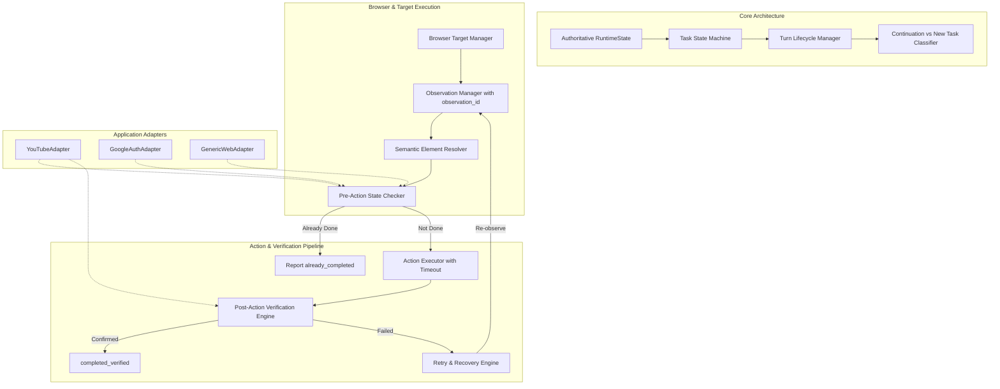

# OpenClaw vs JARVIS Browser Automation Gap Matrix

**Reference Baseline**: OpenClaw v2026.9.2 (`c:/Users/kcs23/Downloads/openclaw-main`)  
**Target Repository**: JARVIS (`E:/jarvis`)  
**Date**: September 2026  
**Auditor**: Senior Autonomous-Agent Systems & Reliability Engineer  

---

## 1. Architectural Gap Matrix

| # | Architectural Dimension | OpenClaw v2026.9.2 Standard | Current JARVIS Status | Gap Severity | Remediation Strategy in JARVIS |
| :--- | :--- | :--- | :--- | :--- | :--- |
| **1** | **Authoritative State Model** | Centralized state (`sessionKey`, `contextEpoch`, `targetId`, `route`, `profile`). | Fragmented state across model memory, desktop `app.py`, and `active_tab_tracker.py`. | **CRITICAL** | Implement `RuntimeState` dataclass in `src/agents/task/runtime_state.py` shared across voice, GUI, channels, and tools. |
| **2** | **Task State Machine & Stages** | Explicit stages per task (`planning`, `observing`, `executing`, `verifying`, `completed_verified`). | Direct execution without observable intermediate stages. | **CRITICAL** | Implement `TaskStateMachine` enforcing strict transitions; forbid jumping from click to `completed_verified`. |
| **3** | **Pre-Action State Check** | Model guidance & pre-flight checks enforce inspecting DOM state before acting. | Blind click dispatched; does not check if action is already complete. | **CRITICAL** | Introduce `PreActionChecker`: inspects whether desired state (e.g. "Subscribed") is already active; returns `already_completed` if true. |
| **4** | **Post-Action Verification** | Result precedence: `effect: "confirmed" > unverifiable > suspected_noop`. | Naively returns `{"ok": true}` when locator click succeeds; reports success without DOM proof. | **CRITICAL** | Enforce `ActionVerificationEngine`: takes post-action snapshot, compares against expected postconditions, outputs verified evidence. |
| **5** | **Target & Tab Management** | `SessionTabRegistry` with target IDs, aliases, and route ownership. Stale target triggers refresh. | `ActiveTabTracker` exists in `src/application_automation`, but standard `BrowserTool` bypasses tab validation. | **HIGH** | Wire `BrowserTargetManager` into all `BrowserTool` actions; raise `TargetStaleError` on closed/stale tabs and auto-recover. |
| **6** | **Selector Resolution & Stale Refs** | Semantic `elementRef` (`axN`) bound to immutable `observationId`. Invalidation on navigation/mutation. | Ad-hoc CSS selectors; Playwright times out 30s; model invents random new CSS selectors. | **CRITICAL** | Implement `ObservationManager` generating `observation_id` + ARIA refs; auto-invalidate refs on page navigation/mutation. |
| **7** | **Turn Boundary & Lifecycle** | `prepareToolCall` checks `AbortSignal` & turn context; immediate rejection of orphaned/delayed calls. | Reactive string check `if not current_user_speech`; delays can slip through or valid calls get suppressed. | **HIGH** | Introduce `TurnLifecycleManager` binding each tool call to `active_user_turn_id`; reject stale calls with `reject_stale_tool_call`. |
| **8** | **Continuation vs New Task** | Classifies whether user prompt continues active session/tab or starts an independent goal. | Model often opens redundant tabs or performs unrelated queries in the active tab. | **HIGH** | Implement `TaskClassifier`: categorizes intent into `continuation`, `new_task`, `correction`, `cancellation`, `unrelated_question`. |
| **9** | **Retry Policy & Idempotency** | Structured refusal codes (`background_occluded`, `off_space`); retry budget; forbids blind mutation retries. | Blindly retries arbitrary CSS selectors in a loop until token limit or crash. | **CRITICAL** | Implement `RetryPolicyEngine`: budgets max 1 re-observation retry; forbids blind mutation retries for side-effects (subscribe, buy, post). |
| **10** | **Page State Classification** | Contextual page state classification (`youtube_home`, `video_page`, `channel_page`, `google_login`, `captcha`). | Unaware of page transition; uses YouTube selectors on Google login pages or search result pages. | **HIGH** | Implement `PageStateClassifier`: classifies current page type before selecting actions; aborts or switches mode if redirected. |
| **11** | **Authentication & Security** | Strict authentication boundaries; pauses for user action on 2FA/CAPTCHA; zero password leakage in logs. | Tries to interact with login pages without structured auth detection; risks credential guessing. | **HIGH** | Implement `AuthBoundaryManager`: detects `auth_required` / `human_verification_required`; freezes automation; sanitizes all credentials. |
| **12** | **Truthful Final Responses** | Disallows claiming success without verified evidence; structured status codes (`completed_verified`, `already_completed`). | Model hallucinates "I have subscribed" based purely on `ok: true`. | **CRITICAL** | Strict response policy: Model system prompt & tool result formatter only emit affirmative success when evidence is present. |
| **13** | **Real-Time Stage Reporting** | Real-time stage updates via tool events / agent progress bus. | Progress hidden from user; user only hears silence until final announcement or timeout crash. | **MEDIUM** | Hook stage transitions into `_PLUGIN_HOOK_BUS` and console/GUI status indicators (`OBSERVING`, `EXECUTING`, `VERIFYING`). |
| **14** | **Decoupled Architecture** | Browser engine is generic provider; YouTube, Google, WhatsApp are application capability adapters. | Incomplete separation; risks hardcoding YouTube assumptions into the core brain. | **HIGH** | Maintain clean separation: `BrowserProvider` provides generic primitives; `YouTubeAdapter` handles YouTube DOM semantics. |

---

## 2. Technical Remediation Roadmap

---

## 3. Strict Verification Criteria

To close these gaps with verified mathematical certainty:
1. **Pre-Action Invariant**: Every mutation action must run `pre_action_check()`. If the desired state exists prior to action, zero click events may be dispatched.
2. **Post-Action Invariant**: Every mutation action must run `verify_effect()`. No action may report `completed_verified` without concrete DOM delta evidence.
3. **Turn Invariant**: Tool calls with mismatched `turn_id` or cancelled signals must immediately return `REJECTED_STALE_TURN`.
4. **Selector Invariant**: Selectors must never be retried in a blind loop. When element resolution fails, exactly one fresh observation may be taken; if still unresolved, an honest failure must be reported.
5. **LOC Invariant**: `apps/desktop/src/jarvis_desktop/app.py` must stay strictly `< 2,000` lines (current: 1,988).
