# WhatsApp Task & Session State Machine

**Architecture:** JARVIS Desktop Automation State Machine  
**OpenClaw Parity:** Multi-stage task lifecycle, persistent session context, and pronoun/continuation resolution.  

---

## 1. State Machine Definition

```mermaid
stateDiagram-v2
    [*] --> UNINITIALIZED
    UNINITIALIZED --> IDLE : Application detected / Session loaded
    
    IDLE --> RESOLVING_APP : User requests message send
    RESOLVING_APP --> RESTORING_WINDOW : WhatsApp process found but minimized
    RESOLVING_APP --> LAUNCHING_APP : WhatsApp not running
    LAUNCHING_APP --> RESTORING_WINDOW : URI protocol 'whatsapp:' launched
    
    RESTORING_WINDOW --> WINDOW_ACTIVE : SW_RESTORE + AttachThreadInput + Alt bypass verified
    RESTORING_WINDOW --> BLOCKED_ABORT : Window cannot acquire foreground
    
    WINDOW_ACTIVE --> SEARCHING_CONTACT : Ctrl+F and query typed
    SEARCHING_CONTACT --> AMBIGUOUS_DISAMBIGUATION : Multiple matching candidates
    AMBIGUOUS_DISAMBIGUATION --> IDLE : Ask user for clarification
    
    SEARCHING_CONTACT --> CONTACT_RESOLVED : Single strong candidate selected
    CONTACT_RESOLVED --> CHAT_OPENED : Enter pressed, chat header asserted
    
    CHAT_OPENED --> DRAFT_PASTED : Unicode clipboard paste (Ctrl+V)
    DRAFT_PASTED --> SEND_DISPATCHED : Enter key pressed
    
    SEND_DISPATCHED --> VERIFIED_DELIVERED : Post-send observation confirmed
    VERIFIED_DELIVERED --> IDLE : Task fulfilled; Voice reply to user
    
    BLOCKED_ABORT --> IDLE : Truthful error reported; No blind typing
```

---

## 2. States and Invariants

| State | Description | Safety Invariant |
|:---|:---|:---|
| `UNINITIALIZED` | No active WhatsApp session known. | No inputs allowed. |
| `IDLE` | Background session tracked by `ApplicationSessionManager`. | Ready for commands. |
| `RESTORING_WINDOW` | WhatsApp is minimized at `(-32000, -32000)`. | **NO keystrokes dispatched.** Call `ShowWindow(SW_RESTORE)`. |
| `WINDOW_ACTIVE` | Target HWND verified as foreground window. | Safe to dispatch host inputs. |
| `SEARCHING_CONTACT` | Search bar active with contact query. | Search box cleared before typing query. |
| `CONTACT_RESOLVED` | Exact recipient identity confirmed. | Reject if ambiguous. |
| `CHAT_OPENED` | Active conversation header asserted. | Window title matches recipient. |
| `DRAFT_PASTED` | Exact text placed in composer via clipboard. | Zero text alteration or translation. |
| `SEND_DISPATCHED` | Enter pressed. | Idempotency lock active (prevents double send). |
| `VERIFIED_DELIVERED`| Message delivered to chat. | Session updated with `active_contact`. |
| `BLOCKED_ABORT` | Foreground acquisition failed. | **Zero typing.** Report truthful failure. |

---

## 3. Multi-Turn Task Continuity & Follow-Up Turns

When a message is successfully delivered, `ApplicationSessionManager` updates:
- `active_chat`: recipient name
- `active_contact`: recipient name
- `is_foreground`: True
- `last_verified_action`: `verified_{recipient}`

If the user immediately follows up with:
- *"Now tell him I will arrive at 5 PM"*
- *"Say thank you"*
- *"Pheri arko msg pathau: thik cha"*

The `TaskContinuity` engine observes:
1. Active session is fresh ($< 300$ seconds).
2. Active chat already matches the target recipient.
3. It bypasses `RESTORING_WINDOW` and `SEARCHING_CONTACT`, proceeding straight from `CHAT_OPENED` $\to$ `DRAFT_PASTED` $\to$ `SEND_DISPATCHED`.
