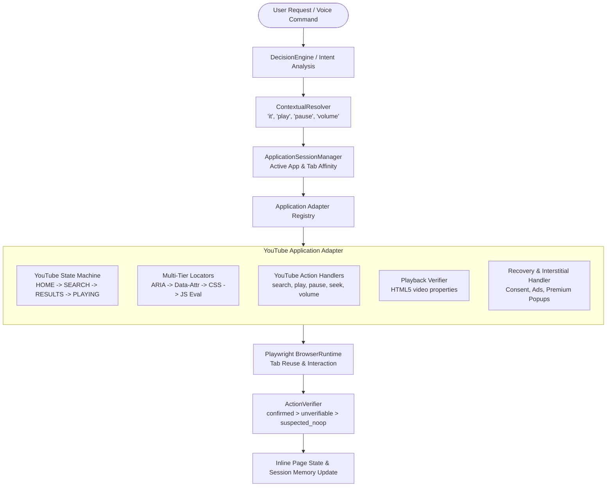

# JARVIS YouTube & Application Automation Architecture

## 1. System Overview & Design Philosophy

JARVIS Application Automation provides a robust, reusable framework for controlling complex interactive web applications without losing context across multi-turn user interactions.

Following OpenClaw's design principles:
- **No monolithic scripts**: Web applications are managed via specialized, modular adapters adhering to a common contract (`BaseApplicationAdapter`).
- **Tab & Session Affinity**: Active tabs and application states are tracked across turns, preventing duplicate browser windows and unnecessary page reloads.
- **State Machine Driven**: Every application interaction progresses through an observable, verifiable finite state machine.
- **Verification-First**: Actions are never assumed successful without inspecting real application outcomes (e.g. verifying that HTML5 `<video>` is playing and advancing time).
- **Graceful Self-Healing**: Transient popups (cookie consent, ads, premium dialogs) and stale DOM references are automatically intercepted and resolved.



---

## 2. Directory & Module Structure

The automation runtime is housed under `src/application_automation/`:

```text
src/application_automation/
├── __init__.py
├── active_tab_tracker.py         # Tracks open tabs, labels, domains, and foreground status
├── application_session_manager.py # Binds applications to sessions and manages adapter lifecycle
├── contextual_resolver.py        # Resolves anaphora ('play it', 'pause', 'this song')
├── state_machine.py              # Base finite state machine implementation
├── action_verifier.py            # Precedence-based action effect verification
├── applications/
│   ├── __init__.py
│   ├── base.py                   # BaseApplicationAdapter abstract base class
│   └── youtube/
│       ├── __init__.py
│       ├── adapter.py            # YouTubeAdapter implementing BaseApplicationAdapter
│       ├── state_machine.py      # YouTube-specific state machine (HOME, RESULTS, PLAYING, etc.)
│       ├── locators.py           # Multi-tier resilient locators for YouTube DOM
│       ├── actions.py            # High-level actions (search, play, pause, skip_ad, etc.)
│       ├── verifier.py           # HTML5 video playback and DOM state verifier
│       └── recovery.py           # Cookie consent, promotional modal, and ad dismissers
```

---

## 3. Core Component Specifications

### 3.1 `ActiveTabTracker` & `ApplicationSessionManager`
- **Responsibilities**:
  - Maintains registry of open tabs indexed by `target_id` and semantic `label` (e.g. `label="youtube"`).
  - Associates tabs with an identified `application_type` (`"youtube"`, `"generic"`, etc.).
  - Tracks the `active_application` and `active_target_id`.
  - Provides safe tab reuse: if YouTube is already open, brings the tab to the foreground without issuing a destructive `goto()` navigation.

### 3.2 `ContextualResolver`
- **Responsibilities**:
  - Resolves pronouns and elliptical commands when the user gives ambiguous requests:
    - *"play it"* $\rightarrow$ If active app is YouTube with search results, select first result and play; if paused video, resume.
    - *"pause"* / *"stop the music"* $\rightarrow$ Send pause action to active YouTube adapter.
    - *"skip"* / *"skip ad"* $\rightarrow$ Trigger ad skip or advance to next video.
    - *"louder"* / *"volume up"* $\rightarrow$ Adjust YouTube player volume.
  - Generates application context prompt blocks for model grounding.

### 3.3 `YouTubeStateMachine`
- **States**:
  - `UNINITIALIZED`: No YouTube tab open.
  - `HOME`: YouTube homepage loaded.
  - `SEARCHING`: Search query entered into search input.
  - `SEARCH_RESULTS`: Search result video list displayed.
  - `WATCH_PAGE`: Navigated to watch URL (`/watch?v=...`).
  - `AD_PLAYING`: Video advertisement currently active.
  - `VIDEO_PLAYING`: Primary video is actively rendering frames and advancing `currentTime`.
  - `VIDEO_PAUSED`: Primary video is paused.
- **Transitions**: Validates transitions and logs unexpected jumps for self-healing.

### 3.4 Multi-Tier Resilient Locators (`locators.py`)
To prevent brittleness from YouTube DOM updates, locators follow a 4-tier cascade:
1. **Tier 1 (ARIA / Role)**: Accessible labels (`input[aria-label="Search"]`, `button[aria-label="Play (k)"]`, `button[aria-label="Pause (k)"]`).
2. **Tier 2 (Semantic Attributes & Tag Names)**: `ytd-searchbox`, `ytd-video-renderer`, `#video-title`, `button.ytp-play-button`.
3. **Tier 3 (CSS / XPath Fallbacks)**: Hierarchical CSS selectors targeting player controls and result cards.
4. **Tier 4 (JavaScript DOM API Evaluation)**: Direct JavaScript execution via Playwright (`page.evaluate("document.querySelector('video').play()")`), completely immune to UI styling changes.

### 3.5 Playback Verifier (`verifier.py`)
Inspects real media playback metrics via JavaScript evaluation on HTML5 `<video>` elements:
```javascript
() => {
  const v = document.querySelector('video');
  if (!v) return { found: false };
  return {
    found: true,
    paused: v.paused,
    currentTime: v.currentTime,
    duration: v.duration,
    ended: v.ended,
    readyState: v.readyState, // 3 or 4 = HAVE_FUTURE_DATA / HAVE_ENOUGH_DATA
    volume: v.volume,
    muted: v.muted
  };
}
```
Verifies that `paused == false` and that `currentTime` advances across a brief observation window.

### 3.6 Interstitial & Popup Recovery (`recovery.py`)
Automatically detects and handles:
- **Google Cookie Consent**: Dismisses *"Accept all"* or *"Reject all"* dialogs (`form[action*="consent"] button`, `button[aria-label*="Accept"]`).
- **YouTube Premium Promotions**: Dismisses *"No thanks"* or close buttons (`#dismiss-button`, `yt-button-renderer:has-text("No thanks")`).
- **Video Advertisements**: Detects `.ytp-ad-player-overlay` or `.video-ads`; automatically clicks `.ytp-skip-ad-button` or `.ytp-ad-skip-button-modern` as soon as it becomes clickable.

---

## 4. End-to-End Workflow: Multi-Turn YouTube Request

```text
Turn 1: "Open YouTube"
1. User input processed -> DecisionEngine selects YouTube application open.
2. ApplicationSessionManager checks for existing YouTube tab.
   - If none: Browser opens 'https://www.youtube.com' with label='youtube'.
   - If exists: Focuses tab, avoids page reload.
3. YouTubeAdapter initializes state machine to HOME.
4. ActiveTabTracker records active application as 'youtube', tabId='youtube'.
5. Returns confirmation: "YouTube is open and ready."

Turn 2: "Search Believer and play it"
1. User input processed -> ContextualResolver sees active app 'youtube'.
2. Intent resolved to: search_and_play(query='Believer').
3. YouTubeAdapter.search('Believer'):
   - Focuses searchbox, types 'Believer', submits search.
   - State machine transitions HOME -> SEARCHING -> SEARCH_RESULTS.
4. YouTubeAdapter.play_first_result():
   - Locates first video card matching 'Believer'.
   - Clicks video link.
   - State machine transitions SEARCH_RESULTS -> WATCH_PAGE.
5. Recovery check:
   - Verifies if pre-roll ad is active; skips if button available.
6. PlaybackVerifier:
   - Polls <video> element until readyState >= 3 and paused == false.
   - Returns confirmed: "Now playing 'Imagine Dragons - Believer' on YouTube."
```
